# המסע לגיטרה חשמלית — The Electric Guitar Journey

An interactive, 11-slide **Hebrew (RTL)** presentation about learning electric guitar and progressing over time. Its central idea: *guitar progress is a map, not a ladder.* Skills develop at different rates, so the deck lets viewers map their own profile and carries it through the whole presentation.

It uses HTML/CSS/vanilla JS, **Three.js** for a 3D guitar inspired by Jimmy Page's Les Paul "Number One", and **Python** for a data engine that generates all the music-theory data shown on the interactive fretboard.

> **Status: iteration 006 (release-readiness review).** Earlier: 005 (distribution: GitHub Pages, standalone HTML, Windows launcher) and 004 (practice planner and cross-slide coherence). The deck is complete and usable on desktop and mobile. Viewers rate themselves (slide 2), explore the map (slide 3), learn the skills (slides 4–9), build a personal practice session (slide 10) and get a personal summary (slide 11). The historical and resource claims are checked against linked sources ([`docs/content-sources.md`](docs/content-sources.md)). See [Limitations](#limitations).

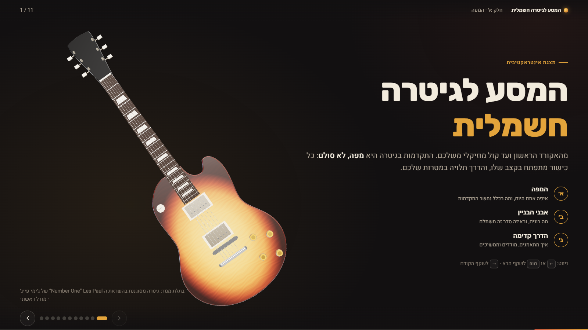

| | |
|---|---|
| 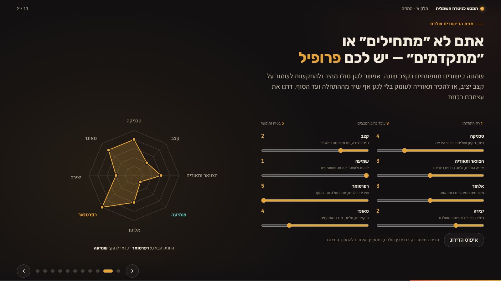 | 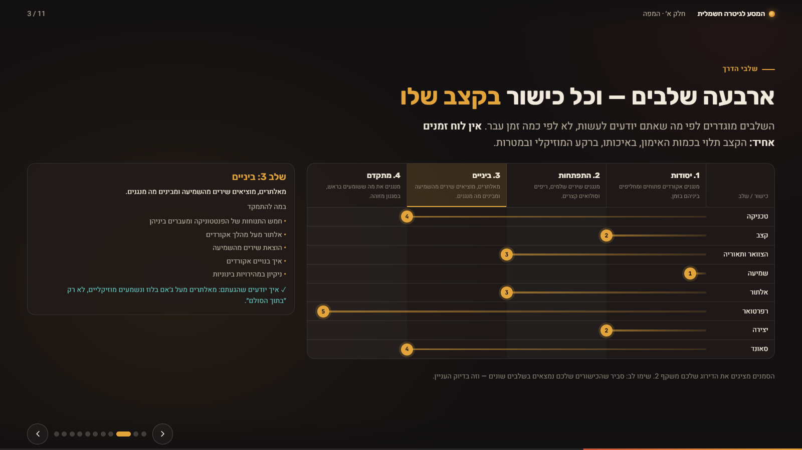 |
| **Slide 2:** self-assessment radar | **Slide 3:** roadmap lanes showing your own ratings |
| 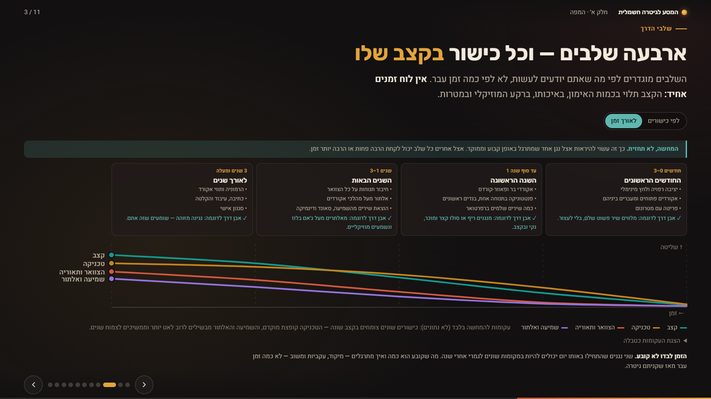 | 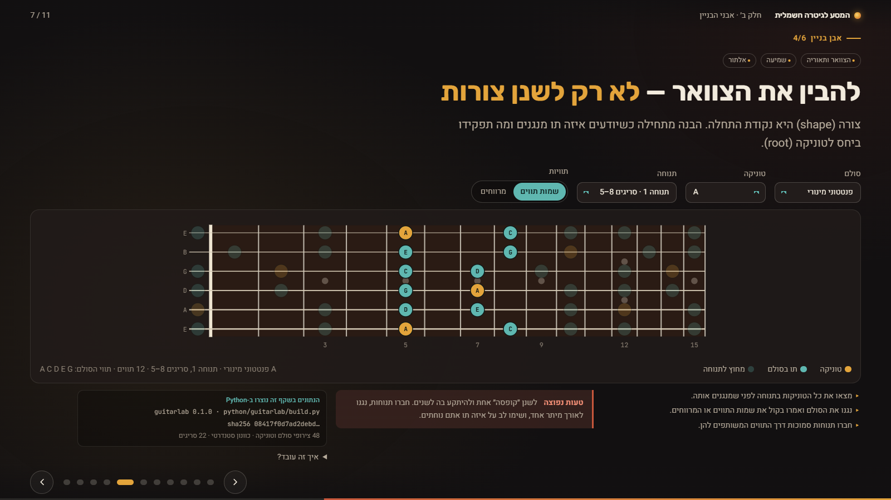 |
| **Slide 3, "over time" view:** illustrative phases and growth curves | **Slide 7:** fretboard rendered from Python-generated data |
| 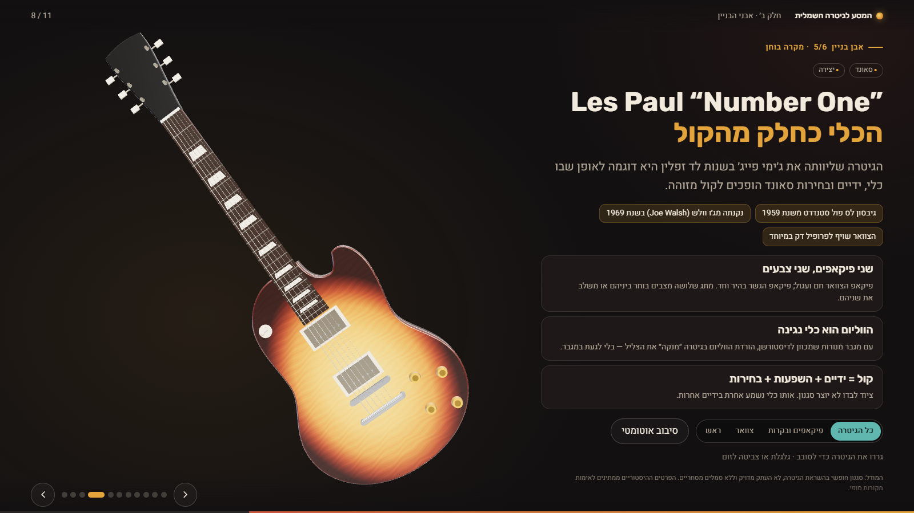 | 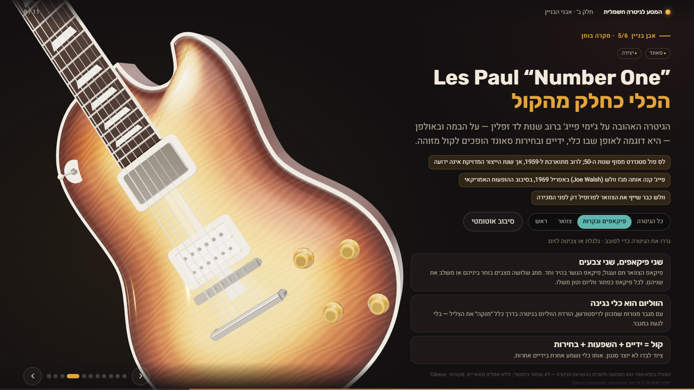 |
| **Slide 8:** explorable 3D guitar | Carved top, burst, and the uncovered bridge pickup |
| 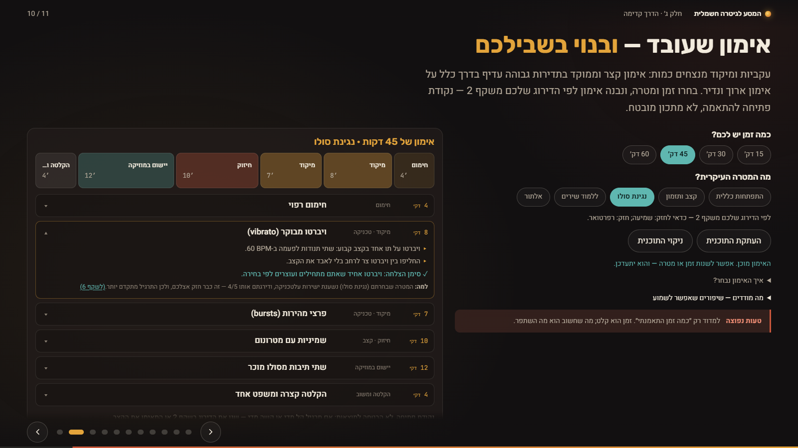 | 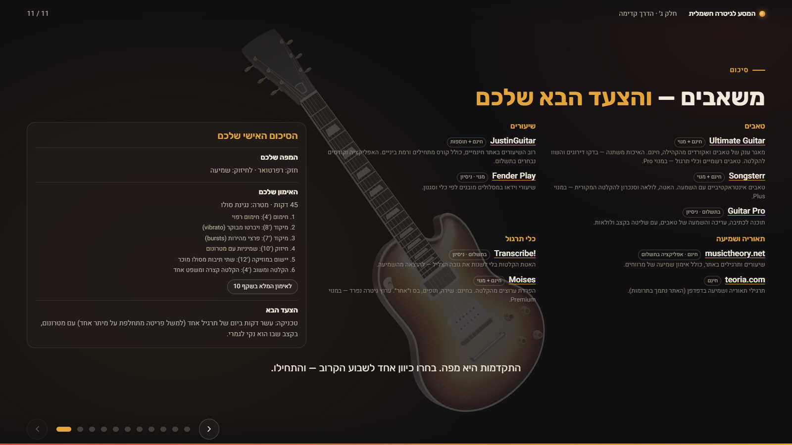 |
| **Slide 10:** personal practice planner (45 minutes, lead goal) | **Slide 11:** personal summary that references the plan |

| Mobile: slide 1 | Mobile: slide 8 | Mobile: slide 7 |
|---|---|---|
| 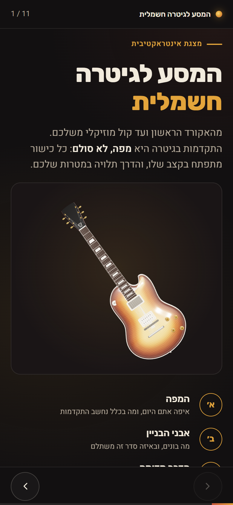 | 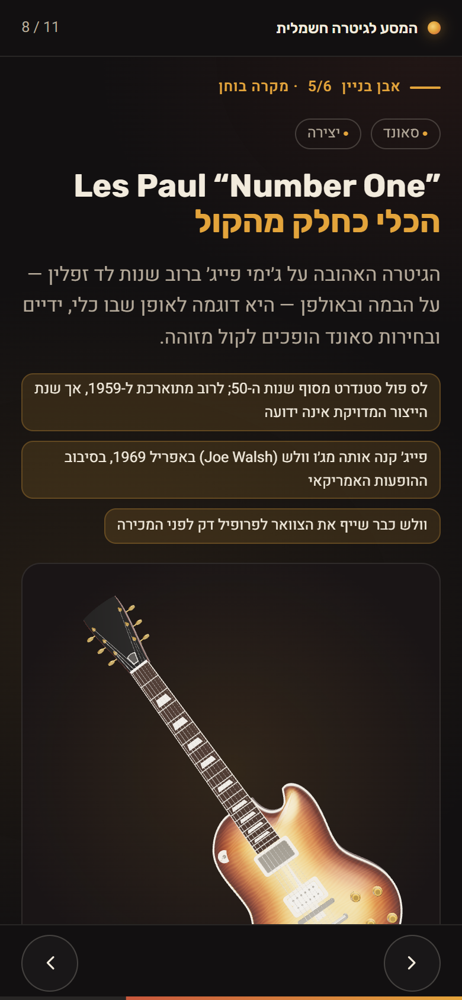 | 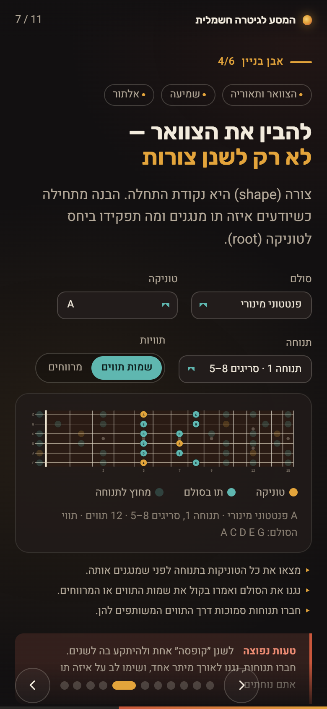 |

On phones the guitar renders only inside in-flow viewer boxes, never behind text. All screenshots are in [`docs/screenshots/`](docs/screenshots/).

---

## Running the presentation: three ways

| | Best for | Needs | How |
|---|---|---|---|
| **1. GitHub Pages** | Sharing and evaluation (recommended) | A browser | Open the site URL |
| **2. Standalone HTML** | Offline, portable, double-click | A browser | Open `dist/presentation.html` |
| **3. Local launcher** | Development and live demos from the repository | Python 3.8+ | Double-click `launch.bat` |

All three run the **same presentation**: 11 slides, the 3D guitar, radar, roadmap, Python-generated fretboard, practice planner and summary.

### 1. GitHub Pages (recommended for sharing)

The workflow in `.github/workflows/pages.yml` runs the Python tests, the data freshness check and the planner unit tests, builds `dist/site/`, and deploys it.

**To enable it** (once the repository is on GitHub):

1. Go to **Settings → Pages → Build and deployment → Source** and choose **GitHub Actions**.
2. Push to `main`, or run the workflow manually under **Actions → Deploy to GitHub Pages → Run workflow**.
3. The deployed URL appears in the workflow summary, and under Settings → Pages.

**URL structure** (for example, user `itamar`, repository `guitar-journey`):

| URL | What it is |
|---|---|
| `https://itamar.github.io/guitar-journey/` | The presentation (`index.html`) |
| `https://itamar.github.io/guitar-journey/#/7` | Deep link to slide 7 (any `#/1` … `#/11`) |
| `https://itamar.github.io/guitar-journey/presentation.html` | The standalone single-file version, for downloading or offline use |
| `…/src/…`, `…/assets/…` | Scripts, styles, the generated data and fonts |

Every path in the project is relative, so the site works under any repository subpath. This is tested by serving `dist/site` under `/guitar-journey/` (`npm run test:pages`).

### 2. Standalone HTML (offline, double-click)

```bash
npm install        # once: esbuild + puppeteer-core (dev tooling only)
npm run build      # -> dist/presentation.html  (about 0.9 MB)  and  dist/site/
```

Double-click `dist/presentation.html`, or copy that single file anywhere (a USB stick, an email attachment). It runs from `file://` with **no server, no Python and no internet**. Everything is embedded: the bundled JavaScript (including Three.js), the CSS, the fonts and the Python-generated fretboard data. The build fails if any external resource reference remains, and `npm run test:standalone` runs the full browser suite against the file with the network switched off.

**Differences from the served version:**

- **Saved progress:** ratings and the plan are saved in `localStorage` as usual. Chrome and Edge share `file://` storage between local files, while Firefox keeps it per file. If storage is blocked, the deck still works but forgets choices on reload (all storage calls are guarded).
- **Copy button:** "Copy the plan" uses the clipboard API, with a timed fallback, because `file://` pages may not get clipboard permission.
- **Updates:** the file is a snapshot of the build. Rebuild after changing the source or the Python data.

### 3. Local launcher (Windows)

Double-click **`launch.bat`** in the repository root. It:

- finds Python 3.8+ (`python`, then `py -3`), or explains how to install it;
- starts a local server on `http://127.0.0.1:8000/` (localhost only) and opens your default browser;
- **reuses** an instance that is already serving this folder instead of starting a duplicate;
- **skips busy ports**: if another program is using 8000, it moves to 8001, and so on up to 8009;
- **stops** when you press **Ctrl+C** or close its window.

Options: `launch.bat --port 9000`, `launch.bat --no-browser`. The launcher works from paths with spaces and non-Latin (e.g. Hebrew) characters. On macOS or Linux, run the same server with `python3 scripts/serve.py` (or `npm start`).

The launcher is optional. Plain `python -m http.server 8000` still works too, though on some Windows machines it serves `.js` files with the wrong MIME type, which breaks ES modules; `serve.py` avoids that.

### Commands

| Task | Command |
|---|---|
| Run the source locally | `launch.bat` · `npm start` · `python scripts/serve.py` |
| Build the standalone HTML and the Pages site | `npm run build` (standalone only: `npm run build:standalone`) |
| Test the standalone file (`file://`, offline) | `npm run test:standalone` |
| Test the Pages site under a subpath | `npm run test:pages` |
| Build and test both artifacts | `npm run test:dist` |
| Test the source version | `npm run test:browser` · `npm run test:unit` · `cd python && python -m pytest` |

### Why `dist/` is not committed

`dist/` is generated and listed in `.gitignore`:

- it is about 0.9 MB of minified code, which would bloat the history on every change;
- it could silently fall out of date with the source;
- CI rebuilds it from source for every Pages deployment.

To share the offline file, take it from the deployed site (`…/presentation.html`), attach it to a GitHub Release, or run `npm run build`.

### Navigation

| Action | Keys / input |
|---|---|
| Next slide | `←` · `↓` · `Space` · `PageDown` · on-screen ‹ button (left) · swipe right |
| Previous slide | `→` · `↑` · `Shift+Space` · `PageUp` · on-screen › button (right) · swipe left |
| First / last | `Home` / `End` |
| Jump to a slide | Progress dots, or a deep link such as `http://localhost:8000/#/7` |

In RTL, "forward" points left. `PageDown` and `Space` always advance, so presentation clickers work. Arrow keys are ignored while a form control (a slider or select) has focus.

---

## The viewer's journey: shared state across slides

| Slide | What the viewer does | State it reads or writes |
|---|---|---|
| 2 | Rates 8 skills (1–5) | writes `ratings` (localStorage) |
| 3 | Sees each skill's position on the roadmap, or the illustrative "over time" view | reads `ratings` |
| 4–9 | Learns what each skill involves (the planner's exercises come from these slides) | none |
| 10 | Chooses a duration and a goal, and generates a practice session | reads `ratings`, writes `planState` (choices only) |
| 11 | Gets a summary: their map, their plan, and one next step | reads `ratings` and `planState` |

The plan itself is **never stored**. It is always recomputed from the current ratings and choices by one function, `buildPlan()` in `src/js/core/planner.js`, so slides 10 and 11 cannot disagree. Skipping slide 2 or slide 10 is fine: the planner says it is working from the goal and time only, and slide 11 offers to send the viewer back.

## The practice planner (slide 10)

Pick **15, 30, 45 or 60 minutes** and a goal (**general development, rhythm, lead, songs, improvisation**), then press **"בנו לי אימון"** (build me a session). Each block shows:

- the time;
- a concrete exercise with steps (tempos are written in);
- an observable **success criterion**;
- **why** it was chosen;
- a link to the slide that teaches it.

Changing the duration, goal or ratings updates the session live. **"העתקת התוכנית"** (copy the plan) copies it as readable text, and **"ניקוי התוכנית"** (clear the plan) clears it.

**How the session is chosen** (deterministic; the same rules are explained on the slide):

1. **The duration picks a fixed layout:**
   - 15 min: warm-up, focus, application.
   - 30 min: adds a support block.
   - 45 and 60 min: add a short recording-and-reflection block, and split the focus block into a main exercise and a slightly harder variant.
2. **Focus skill** is the highest `0.6 × goal relevance + 0.4 × need` among the skills that serve the goal, where `need = (5 − rating) / 4`. The goal leads, and weaknesses shift the choice. The skill trained by the application block is excluded.
3. **Support:** if rhythm or technique is rated 2 or lower, it takes the support block whatever the goal ("maintain foundations"). Otherwise the next-best scoring skill does.
4. **Application:** every session ends by playing real music: a song with a click (rhythm), two bars of a known solo (lead), a full song or a looped hard passage (songs, general), or a jam (improvisation).
5. **Exercises** are matched to the skill's rating. Goal-specific variants are preferred, e.g. bends and vibrato for the lead goal.

The output is a **practical starting point, not a scientifically optimised programme**, and the slide says so. The logic is covered by 14 unit tests (`npm run test:unit`).

---

## Python: the data engine

`python/guitarlab/` generates every note, interval, scale spelling and position that the fretboard displays. It also generates the equal-temperament fret positions that space the 2D fretboard to scale and place the frets on the 3D model.

```bash
# requires Python 3.11+ (the launcher alone only needs 3.8+)
cd python
python -m venv ../.venv && ../.venv/Scripts/activate      # macOS/Linux: source ../.venv/bin/activate
pip install pytest

python -m guitarlab.build            # regenerate src/data/fretboard.json
python -m guitarlab.build --check    # exit 1 if the committed JSON is stale
python -m pytest                     # 27 tests
```

| Module | Purpose |
|---|---|
| `theory.py` | Pitch classes; correctly spelled scales (F major → Bb, E major → G#); interval labels. Minor/major pentatonic, natural minor and major, in 12 keys each. |
| `fretboard.py` | Standard tuning; note grid for frets 0–22; the 5 pentatonic positions, generated by walking the scale two notes per string; fret distances `d(n) = L·(1 − 2^(−n/12))` |
| `build.py` | Deterministic JSON output with a SHA-256 content hash; `--check` mode |

**Data flow.** Python runs **at build time**, not in the browser: `python -m guitarlab.build` → `src/data/fretboard.json` (with a SHA-256 hash) → JavaScript in the browser reads the file and draws the fretboard, and places the frets on the 3D model. Slide 7 explains this to viewers in plain Hebrew in an **"איך זה עובד?"** (how this works) panel, next to the provenance badge.

**How to verify that Python powers the presentation:**

1. Slide 7's provenance badge shows the generator version and the data hash. Hover it to see the full hash, and compare it with the output of `--check`.
2. Rename `src/data/fretboard.json` and reload. The fretboard shows a "data not loaded" error and draws no notes, because the JS contains no built-in theory data. The rest of the deck keeps working.
3. Change the generator (for example, add a scale), rebuild, and reload: the fretboard picks it up.

---

## Browser smoke test (optional)

```bash
npm install                 # dev tooling: esbuild (build) + puppeteer-core (drives your installed Chrome/Edge)
npm run test:unit           # 14 planner logic tests (node:test, no dependencies)
npm run test:browser        # 57 checks against the source (served)
npm run test:standalone     # same checks + 'no network requests' against dist/presentation.html (file://, offline)
npm run test:pages          # same checks + 'stays under the subpath' against dist/site under /guitar-journey/
npm run screenshots         # same checks, and refreshes docs/screenshots/
```

The test checks:

- navigation (keys, buttons, dots, deep links, progress, the first/last button states);
- the fretboard against the generated JSON (note counts, roots, spelling, interval labels, hiding the position control for 7-note scales);
- that arrow keys inside a `<select>` don't change slides;
- radar → roadmap → summary, and persistence across reloads;
- the planner:
  - every duration, with blocks summing correctly;
  - goal and rating changes alter the focus;
  - the unrated path;
  - copy to clipboard;
  - keyboard arrows inside the option groups;
  - reset;
  - slide 11 referencing the plan after a reload;
- BiDi isolation of tempos in generated text;
- the slide 7 data-flow panel;
- the slide 3 view toggle;
- the mobile layout at 390×844 on every slide (the guitar only inside viewer boxes, the nav bar clear of content, no horizontal overflow, 44px nav targets and planner controls);
- 3D initialisation, frets coming from the generated data, and the slide 8 controls;
- **no console errors or failed requests**.

Set `CHROME_PATH` if Chrome isn't found automatically. Set `SOFTWARE_GL=1` to force software WebGL.

---

## Project structure

```
index.html                 # the presentation (lang="he" dir="rtl"), 11 slides
launch.bat                 # Windows one-click launcher (runs scripts/serve.py)
scripts/                   # build.mjs (standalone + Pages site) · serve.py (local server)
.github/workflows/         # pages.yml (test, build, deploy to GitHub Pages)
dist/                      # GENERATED by npm run build (not committed)
src/
  css/                     # tokens.css · base.css · deck.css · components.css
  js/
    main.js                # boot: deck, components, data loading, lazy 3D
    core/                  # deck.js · ratings.js · planner.js (recommendation logic) · plan-state.js
    content/skills.js      # Hebrew skill/stage content shared by components
    content/exercises.js   # planner exercise library (from slides 4-9)
    components/            # radar · roadmap · timeline · fretboard · planner · summary
    three/                 # stage.js · presets.js · guitar-procedural.js
  data/fretboard.json      # GENERATED by python/guitarlab (do not edit)
  vendor/three/            # Three.js r160 (MIT), pinned and vendored for offline use
assets/fonts/              # Heebo, Rubik, JetBrains Mono (SIL OFL), self-hosted
python/                    # guitarlab package + tests
tests/browser/smoke.mjs    # headless browser smoke test (source, standalone and Pages modes)
tests/js/planner.test.mjs  # planner logic unit tests (node:test)
docs/
  PLANNING.md              # concept, outline, trade-offs, decisions
  architecture.md          # data flow, module map, 3D model contract, RTL rules
  content-sources.md       # every factual claim and its verification status
  iterations.md            # what changed in each iteration, with validation results
  prompts/                 # development prompts, verbatim
  screenshots/
PRD.md                     # product requirements, with implementation status
```

## Design

**"Late-night studio".** Warm near-black backgrounds and off-white text, with sunburst **amber** as the primary accent and a faded **cherry red** for the "common mistake" callouts. **Teal** is reserved for interactive and data elements. Titles use Rubik and body text uses Heebo, both with full Hebrew support; diagram labels use JetBrains Mono.

The slides share a few repeated patterns:

- a kicker and skill chips,
- "how to practise / how you'll know it's working" cards,
- a common-mistake callout,
- a "bridge" line leading to the next slide.

**RTL/BiDi:**

- The page is RTL and uses CSS logical properties.
- Latin terms and numbers are isolated with `<bdi>`, or with Unicode isolates inside `<option>` text.
- **Musical diagrams keep their conventional LTR orientation:** fretboard (nut on the left, high E on top, as in tab), the rhythm diagram, and the 3D guitar.
- Progress UI follows Hebrew direction.

Details: [`docs/architecture.md`](docs/architecture.md).

## Documentation

- [`PRD.md`](PRD.md): requirements, priorities (with status), design decisions, success criteria
- [`docs/PLANNING.md`](docs/PLANNING.md): concept, narrative, trade-off analysis, roadmap
- [`docs/iterations.md`](docs/iterations.md): iteration log, including what was tested and how
- [`docs/prompts/`](docs/prompts/): the development prompts, verbatim (001–006)
- [`docs/compliance.md`](docs/compliance.md): assignment-requirement checklist with references

## Limitations

- **3D guitar:** a detailed *procedural* illustration (carved top, edge-following burst, sourced Number One details), at about 60 fps on an integrated GPU. It is not photoreal and not a historical reproduction. A Blender GLB can replace it through the model contract.
- **Content verification:** done in iteration 003, with direct links. A few tier claims (JustinGuitar, Moises, Fender Play) rely on search-indexed official pages because direct fetches were blocked. Re-check pricing before presenting.
- **Browser coverage:**
  - The full automated suite (57–58 checks) runs in headless **Chrome** on Windows, against the source, the standalone file and the Pages site. The standalone suite also passed in **Edge**.
  - **Firefox:** only a focused check of the standalone file was run (navigation, 3D, fretboard data, planner, summary, storage, console errors), not the full suite.
  - **Not tested:** Safari, real phones and tablets (mobile layouts were checked in emulation at 390×844), and screen readers.
- **Frame rate:** about 60 fps on an integrated Intel GPU; only 2–4 fps with software WebGL (machines without GPU acceleration).
- **Lighthouse (desktop, iteration 004):** Accessibility 100 and Best Practices 100. **Performance 75–79**, below the internal target of 85. The cause is synchronous WebGL setup (the environment map and shader linking), about 0.4–0.5 s of blocking time after the first paint. The accessibility score is automated only; there has been no manual screen-reader review.
- **CI / GitHub Pages:** `.github/workflows/pages.yml` exists, and every one of its build steps was replayed successfully on Ubuntu with Node 22 and Python 3.12. **It has not yet run on GitHub, so the deployment itself is unverified.**
- **Deferred (by decision):** metronome, audio synthesis, 3D hotspots, YAML content pipeline.

## Third-party licences

| Component | Licence |
|---|---|
| Three.js r160 (`src/vendor/three/`) | MIT. See `src/vendor/three/LICENSE`. |
| Heebo, Rubik, JetBrains Mono (`assets/fonts/`) | SIL Open Font License 1.1. See `assets/fonts/LICENSE-*.txt`. |

The 3D model and its sunburst texture are generated procedurally in code. There are no third-party models or images and no brand logos. The project's own licence has not been chosen yet.
